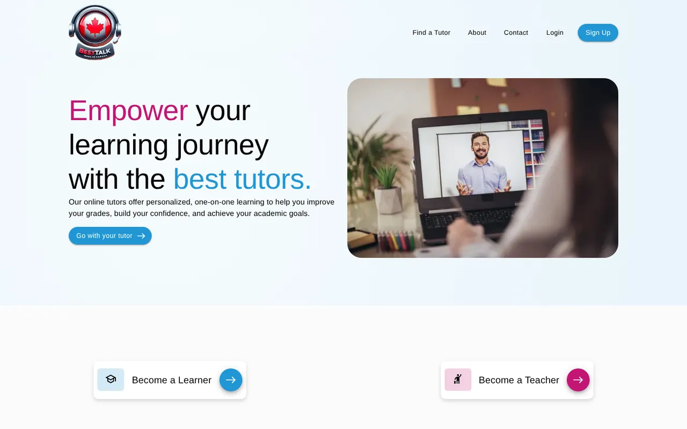
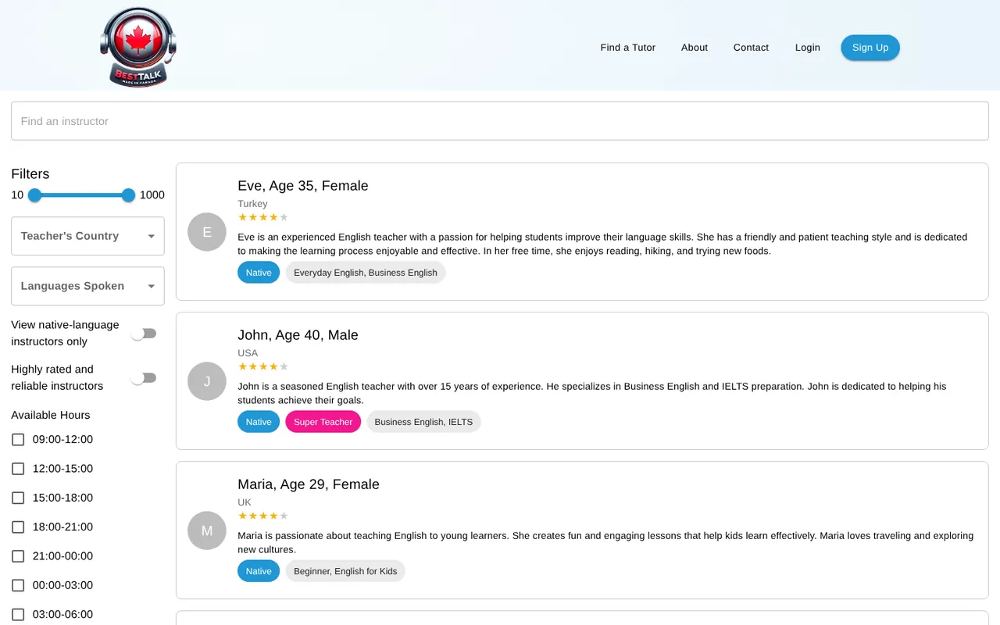
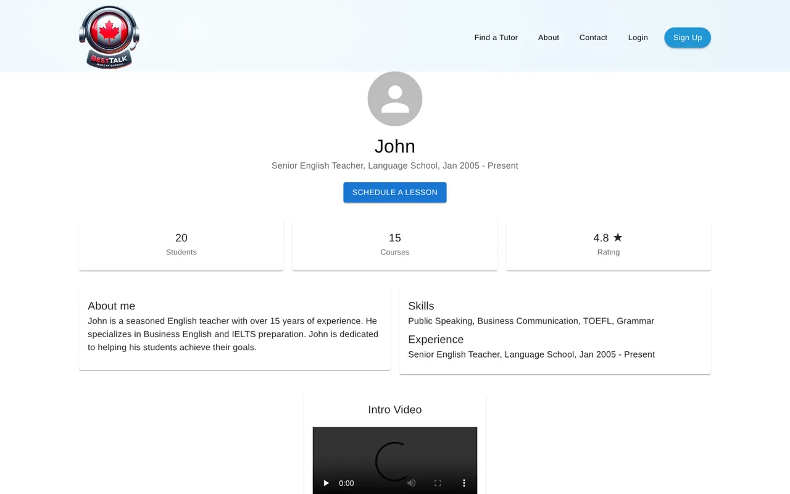
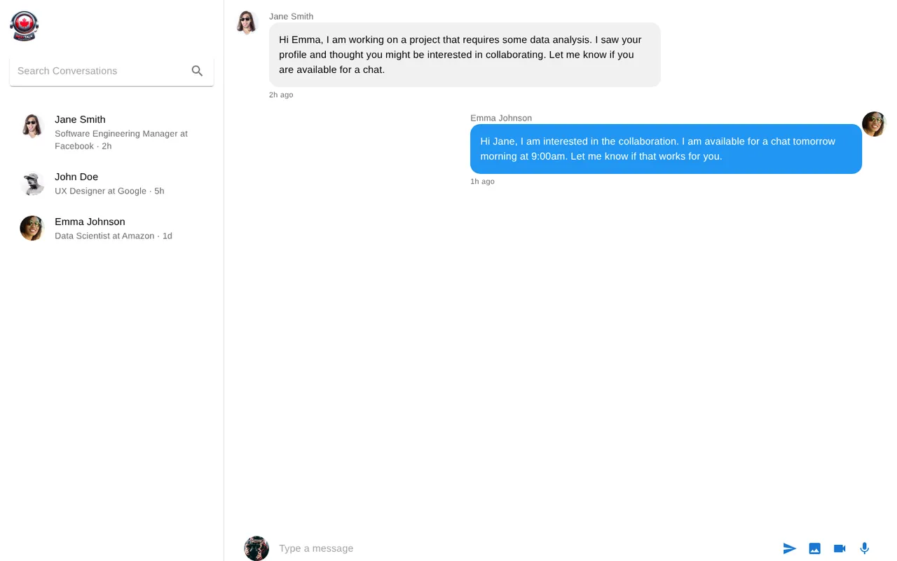
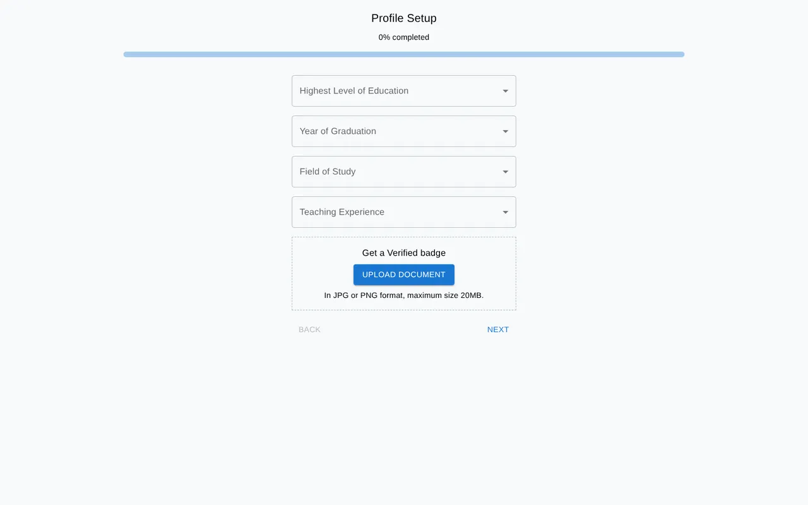
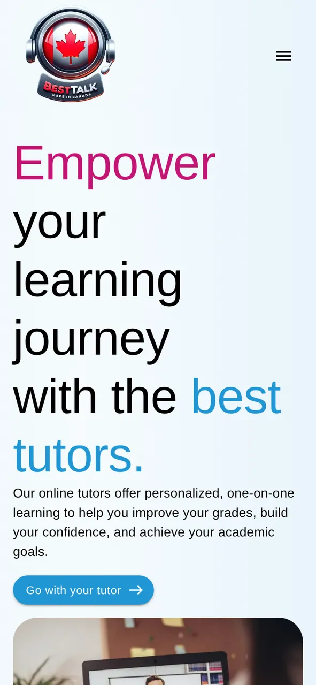

# BestTalk — The Canadian Way

BestTalk is a front-end showcase for a one-on-one online tutoring platform. Learners browse and filter tutors, view profiles and book lessons; tutors sign up through a multi-step onboarding flow; and students, tutors and admins each get their own dashboard.

It is built with React and Material UI. There is no backend: tutors, conversations and dashboard stats are sample data, and sign-in is mocked (see [Demo notes](#demo-notes)).



## Screenshots

| Find a tutor | Tutor profile |
| --- | --- |
|  |  |
| **Chat** | **Tutor onboarding** |
|  |  |

<p align="center"></p>

## Features

- **Landing page:** hero, course categories, "Why choose us", free-trial and "become a tutor" calls to action. The layout is responsive, with a drawer menu on mobile.
- **Tutor search:** filter by price range, country, languages spoken, native speakers, "super teachers", available hours and days, and areas of expertise.
- **Tutor profiles:** stats, bio, skills, experience and an intro video, plus a lesson-scheduling dialog with a Stripe card form.
- **Sign-up flows:** learners answer a short goals questionnaire, and tutors complete an 8-step onboarding wizard (education, subjects, expertise, experience, certifications, introduction, availability).
- **Chat:** send text messages, upload images and video, and record voice notes in the browser with the MediaRecorder API.
- **Dashboards:** separate views for students, instructors and admins.
- **About and Contact pages**, including an auto-playing image carousel.

## Tech stack

- [React 19](https://react.dev/) with [Create React App](https://create-react-app.dev/)
- [Material UI 7](https://mui.com/) and MUI icons
- [React Router 7](https://reactrouter.com/)
- [Stripe Elements](https://stripe.com/docs/stripe-js/react) (UI only, see below)

## Getting started

Requires Node.js 18 or newer.

```bash
git clone https://github.com/m-m4h4d/b-talk.git
cd b-talk
npm install
npm start
```

The app runs at <http://localhost:3000>. To build for production, run `npm run build` and serve the `build/` folder with any static host (Netlify, Vercel, GitHub Pages, …). Configure the host to send every route to `index.html` so client-side routing works.

## Pages

| Route | Page |
| --- | --- |
| `/` | Landing page |
| `/instructor-listing` | Tutor search with filters |
| `/instructors/:id` | Tutor profile and lesson booking, e.g. `/instructors/john` |
| `/signup`, `/login` | Sign up and log in |
| `/question` | Learner goals questionnaire (after signing up as a learner) |
| `/stepper` | Tutor onboarding wizard (after signing up as a tutor) |
| `/chat` | Messaging |
| `/student-dashboard`, `/instructor-dashboard`, `/admin-dashboard` | Dashboards |
| `/about`, `/contact` | About and Contact |

## Demo notes

- **Admin login:** `admin@example.com` / `Bingo.123` opens the admin dashboard. No other accounts exist; the other dashboards can be opened directly from the routes above.
- **Data:** tutors, reviews, conversations and stats are hard-coded sample data, and form submissions are only logged to the browser console.
- **Payments:** the Stripe form uses a placeholder publishable key and no backend, so no real payments are made.

## Project structure

```
src/
├── App.js              # Routes
├── App.css             # Landing page and shared styles
├── Components/         # One file per page or major component
│   └── Steps/          # Tutor onboarding wizard steps
└── Images/             # WebP assets, re-exported from index.js
```

## License

Released under the [MIT License](LICENSE).
